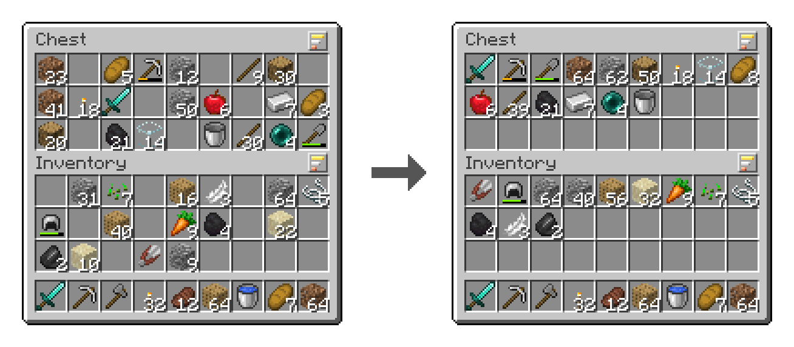

# Tidy Nest

**One click, everything in its place.** A small sort button for your inventory, chests, barrels and shulker boxes, for Minecraft Java Edition (Fabric).

**[⬇ Download the latest release](../../releases/latest)** · [Changelog](CHANGELOG.md) · [afkbird.com](https://afkbird.com/projects/tidy-nest/)

---

## What it does

Open a chest or your inventory and you'll see a small button with three bars above the top-right corner of each grid. Click it and that grid is sorted. That's it: no menus to learn, nothing to set up.

* **Stacks are merged.** Three half stacks of cobblestone become one full stack and a bit.
* **Gear comes first**, best first. Weapons and tools are grouped by type (swords, axes, pickaxes, shovels, hoes, bows...), with the best material first and the least worn first. Armour follows, head to feet, then other gear such as shields.
* **Then blocks, food and potions, materials, other items, and storage** (shulker boxes and bundles) last.
* **What you have most of comes first** within each group, and each item's biggest stack comes before its smallest.
* **Your hotbar, armour and off hand never move.** The inventory button sorts the 27 storage slots only, so what you hold and wear stays where you put it.
* **Shortcuts:** double-click an empty slot (with nothing in your hand) or middle-click any slot to sort its grid without reaching for the button. Middle-click works in survival; in creative it still copies items. Prefer a keyboard key? Set *Sort the area under the mouse* in Controls → Inventory.
* **The same items always end up in the same order**, so things are where you expect them, and sorting a tidy chest changes nothing.

### Works on any server

* **On a server that has Tidy Nest** (and in singleplayer), the server sorts in one step. Players without the mod can still join and play normally.
* **On a server without it**, your game sorts with the same ordinary clicks you'd make by hand, so it works anywhere. It checks every click as it goes and stops safely if the server doesn't keep up. Nothing can be lost: items only move between slots. (Grids with a bundle in them are left alone on these servers, because a bundle in hand would pick items up instead of swapping.)

Supported: player inventory, chests, double chests, trapped chests, barrels, ender chests, chest minecarts and boats, and shulker boxes, plus other mods' containers that use the same screens.

---

## Installing

| You need | Version |
|---|---|
| Minecraft Java Edition | 26.3 |
| [Fabric Loader](https://fabricmc.net/use/installer/) | 0.19.5 or newer |
| [Fabric API](https://modrinth.com/mod/fabric-api) | 0.162.0+26.3 or newer |
| Java | 25 or newer (bundled with the official launcher) |

1. Install Fabric Loader for Minecraft 26.3 with the Fabric installer.
2. Download `tidynest-<version>.jar` from the **[latest release](../../releases/latest)** and Fabric API from its page.
3. Put both jars into your `mods` folder (`%APPDATA%\.minecraft\mods` on Windows). Delete any older `tidynest-*.jar` first.
4. Start the game with the Fabric profile.

**Servers:** optional. Put the same jar in the server's `mods` folder for one-step sorting. Different Tidy Nest versions on the server and in your game work together; the game sorts with clicks if they can't talk.

**Official downloads only come from this page's [Releases](../../releases).** Each release lists SHA-256 checksums in `SHA256SUMS.txt`, and every jar comes with afkbird's signature (`.sig`); see [SECURITY.md](SECURITY.md).

### Staying up to date (Windows)

When a new version is out, the game tells you on the title screen and in chat.

Every release includes **`tidynest-updater.zip`**. Unzip it anywhere and double-click **`update-tidynest.bat`** whenever there's an update:

* It checks GitHub for the newest version. If yours is older (or missing), it downloads it, checks it, and puts it in your mods folder.
* Every official jar is **signed by afkbird**. The updater installs only a correctly signed jar and refuses anything else.
* Your old jar is moved to a `tidynest-backup` folder, not deleted. If anything goes wrong, nothing is changed.
* **Servers:** put the two updater files in the server folder, next to `mods`, and run it while the server is stopped.
* **Prism Launcher and similar:** it can run automatically every time you press Play. See the `README.txt` inside the zip.

### Settings

`config/tidynest.json`:

| Setting | Default | What it does |
|---|---|---|
| `check_for_updates` | `true` | Once per launch, ask GitHub for the newest version number and say if there's a newer one. It never downloads anything. |
| `middle_click_sorts` | `true` | Middle-click a slot to sort its grid. |

---

## Help and feedback

Found a bug or have an idea? [Open an issue](../../issues/new/choose), or ask in #mod-help on the [afkbird Discord](https://afkbird.com/discord). Include your mod version, and the game log if something crashed. Security problems: please report them privately ([SECURITY.md](SECURITY.md)).

## License

**Use it freely, just keep it pointing here.** You may play the mod, run it on any server (paid ones too), make and monetise videos and streams, put the official jar in modpacks, and tweak it privately for your own world. Credit the mod and link to this page. You may not publish modified versions, forks or ports, re-upload the jar on its own, sell it, or reuse its code or art without permission. Ideas, bug reports and permission requests (free or paid): [open an issue](../../issues/new/choose). The full terms are in [LICENSE](LICENSE).

## Credits

Made by [afkbird](https://afkbird.com), the studio of [AVIX-afk](https://github.com/AVIX-afk). The button and icon are original pixel art. The pictures on this page are drawn from Minecraft's own textures; the mod itself contains no Mojang assets.

*Not an official Minecraft product. Not approved by or associated with Mojang or Microsoft.*
